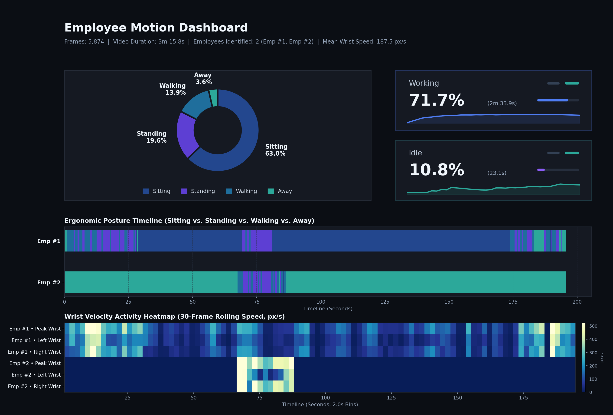
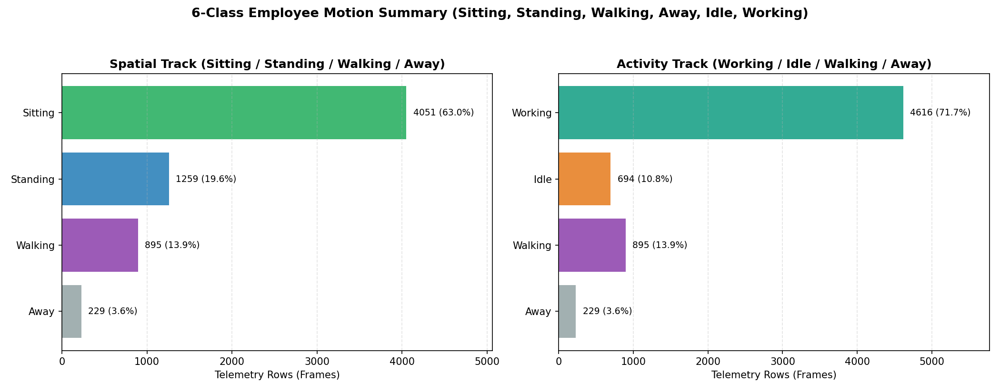
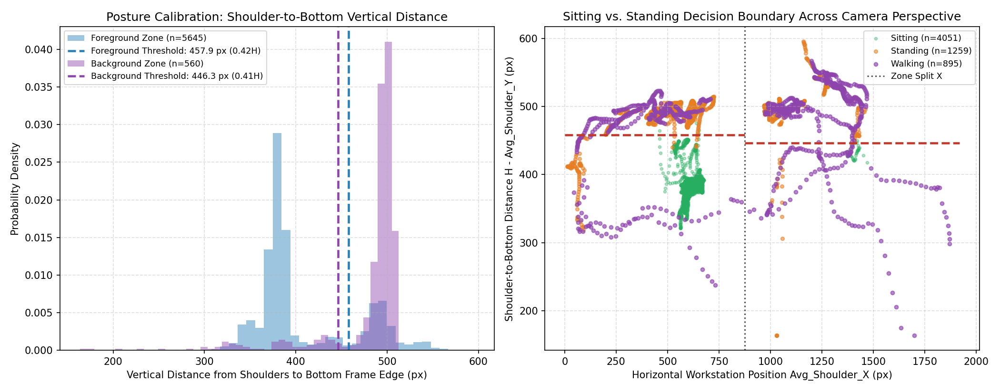
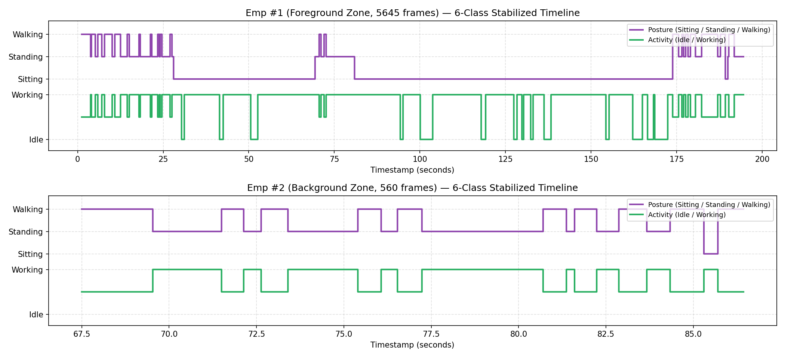
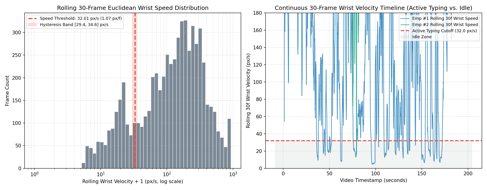

# Employee Motion Tracker & Executive BI Dashboard

Privacy-preserving computer vision and temporal analytics pipeline that tracks 13 anatomical skeletal landmarks using a fine-tuned **YOLOv8n-Pose** model, maintains persistent employee identities across long desk occlusions via privacy-safe torso appearance Re-ID, classifies workstation behavior into **6 calibrated motion states**, and surfaces real-time operational & ergonomic KPIs in an interactive **Streamlit + Plotly** executive dashboard.



---

## Key Engineering Highlights

- **Fine-Tuned Occlusion-Resilient Pose Estimation (`models/best_yolov8n_pose.pt`, 6.5 MB)**:
  - Domain-adapted **YOLOv8n-Pose** trained with synthetic desk-barrier occlusions, directional motion blur, and empty-room hard negatives (**Box mAP50 = `0.9940`**, **Pose mAP50 = `0.9938`**, **`32.7 FPS`** on local CPU).
- **Zero-Lag Directional-Innovation Kalman Smoother (`src/tracking/smoother.py`)**:
  - Suppresses **`54.0%`** of bounding-box and joint coordinate jitter while dynamically boosting velocity covariance during rapid doorway walking (`< 3 px` lag at `600 px/s`).
- **Two-Stage Persistent Employee Re-ID (`src/tracking/multi_tracker.py`)**:
  - Combines kinematic Hungarian matching with an illumination-resilient `HSV + CIE-Lab` upper-torso clothing histogram gallery (shoulders-to-hips only; **zero facial biometrics stored**), eliminating ID fragmentation even across 100+ frame full-desk occlusions.
- **Data-Calibrated 6-Class Motion Engine (`src/calibration/`)**:
  - Replaces hardcoded guesses with 1D KDE valley-finding, Otsu thresholding, perspective-zone calibration, Schmitt-trigger hysteresis, and minimum-dwell anti-flicker filtering across 6 core states: **`Sitting`**, **`Standing`**, **`Walking`**, **`Away`**, **`Idle`**, and **`Working`**.
- **Interactive Executive BI Dashboard & PDF Reporting (`app.py`, `src/dashboard/`)**:
  - Dark-glassmorphic **Streamlit + Plotly** web app featuring Posture & Utilization Donut charts, KPI Sparklines, Ergonomic Gantt Timelines, 2D Wrist Velocity Heatmaps, and one-click **PDF / PNG / CSV** executive exports.

---

## Visual Analytics & Calibration Outputs

| 6-Class Motion Distribution | Posture Perspective Calibration |
| :---: | :---: |
|  |  |

| Stabilized Per-Employee Timelines | Rolling 30-Frame Wrist Velocity Calibration |
| :---: | :---: |
|  |  |

---

## Project Architecture

```text
employee-motion-tracker/
├── .streamlit/config.toml          # Custom dark theme for Streamlit BI app
├── app.py                          # Interactive Streamlit + Plotly Executive Dashboard
├── models/
│   └── best_yolov8n_pose.pt        # Fine-tuned 6.5 MB YOLOv8n-Pose weights (17 COCO keypoints)
├── data/
│   └── raw_videos/                 # Input office video directory (gitignored for privacy)
├── outputs/
│   ├── videos/                     # H.264 annotated tracking videos (gitignored for privacy)
│   ├── telemetry/                  # Anonymized temporal_features.csv & calibrated_thresholds.json
│   ├── plots/                      # Mathematical calibration & jitter-reduction charts
│   └── reports/                    # Executive PDF report, KPI CSV/JSON & dashboard snapshot
├── src/
│   ├── config.py                   # Centralized paths & landmark definitions
│   ├── training/                   # Dataset curation, synthetic occlusion & YOLOv8 fine-tuning
│   ├── tracking/                   # Milestone 1: Pose NMS, Kalman smoothing & Re-ID gallery
│   ├── calibration/                # Milestone 2: KDE/Otsu calibration & 6-class rules engine
│   └── dashboard/                  # Milestone 3: Polars KPI engine, Plotly charts & PDF reporter
├── scripts/
│   ├── run_milestone1.py           # Batch video tracking & Kalman landmark extraction
│   ├── run_milestone2.py           # Threshold calibration & 6-class behavior classification
│   ├── render_classified_video.py  # H.264 video renderer with live Re-ID & motion badges
│   ├── run_dashboard.py            # CLI launcher for Streamlit Executive Dashboard
│   └── generate_report.py          # Standalone batch PDF / PNG / CSV report compiler
├── tests/                          # 24 automated unit, AppTest & output integrity tests
├── packages.txt                    # System packages for Streamlit Community Cloud
└── requirements.txt
```

---

## Quick Start

### 1. Clone & Install Dependencies

```bash
git clone https://github.com/<your-username>/employee-motion-tracker.git
cd employee-motion-tracker
python3 -m venv venv
source venv/bin/activate
pip install -r requirements.txt
```

### 2. Launch the Interactive Executive Dashboard

Because anonymized telemetry (`outputs/telemetry/temporal_features.csv`) is included, you can launch the dashboard immediately:

```bash
python scripts/run_dashboard.py
```

### 3. Run Full Video Tracking, Calibration & Report Generation (Optional)

Place an input MP4 in `data/raw_videos/` and run:

```bash
# Milestone 1: Extract smoothed 13-joint keypoints with persistent Employee Re-ID
python scripts/run_milestone1.py --smoother kalman --no-video

# Milestone 2: Calibrate thresholds & classify into Sitting, Standing, Walking, Away, Idle, Working
python scripts/run_milestone2.py

# Render H.264 annotated video with live employee & motion badges
python scripts/render_classified_video.py

# Milestone 3: Compile standalone PDF, PNG & CSV executive reports
python scripts/generate_report.py
```

### 4. Run Automated Test Suite

```bash
python -m unittest discover -s tests -p "test_*.py" -v
```

---

## Deploying Live on Streamlit Community Cloud

1. Push this repository to GitHub.
2. Sign in to [share.streamlit.io](https://share.streamlit.io) and click **Create app**.
3. Select your repository, branch `main`, and set **Main file path** to `app.py`.
4. Click **Deploy** — Streamlit Cloud automatically installs `requirements.txt` + `packages.txt` and serves the live interactive dashboard.
